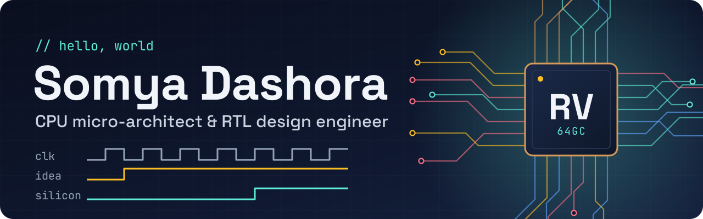
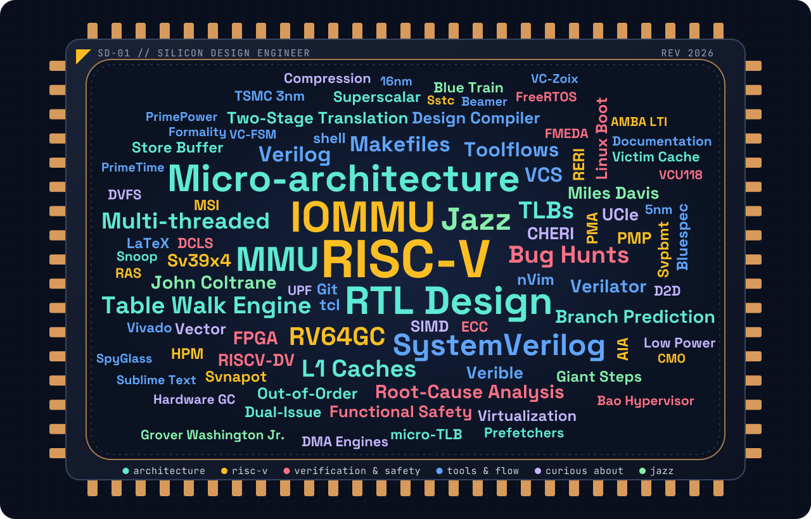
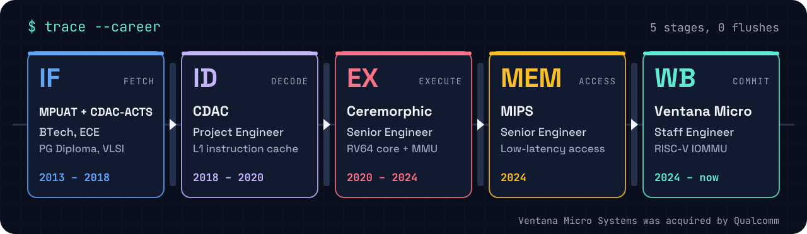

<p align="center">
  
</p>

<p align="center">
  <samp>
    <a href="mailto:somyadashora@gmail.com">email</a> ·
    <a href="https://www.linkedin.com/in/somya-dashora-7a395575/">linkedin</a> ·
    <a href="#-patents--papers">patents</a> ·
    <a href="https://github.com/somyadashora/sd-dotfiles">dotfiles</a>
  </samp>
</p>

## 👋 TL;DR

- Silicon design engineer building **RISC-V processor cores and IOMMUs**, from micro-architecture to RTL.
- **Staff Engineer** at Ventana Micro Systems (acquired by Qualcomm), working remotely from Udaipur, India.
- Happiest deep in a **complex bug hunt**, connecting scattered clues across large specification sets to find the root cause.
- Also the person who enjoys building the **Makefiles, scripts and toolflows** that make everyone else faster.

<p align="center">
  
</p>

## 🧬 Top module

```systemverilog
module somya_dashora #(
  parameter string ISA  = "RISC-V",
  parameter string ROLE = "CPU micro-architect"
) (
  input  logic  jazz_clk,        // throughput scales with Coltrane
  input  spec_t scattered_specs,
  input  bug_t  impossible_bug,
  output rtl_t  clean_rtl,
  output doc_t  useful_docs,
  output rca_t  root_cause
);

  always_ff @(posedge jazz_clk) begin
    root_cause  <= hunt(impossible_bug, scattered_specs);
    clean_rtl   <= design(scattered_specs, root_cause);
    useful_docs <= explain(clean_rtl);
  end

endmodule
```

## 🛣️ Career pipeline

<p align="center">
  
</p>

## 🔬 Silicon I've worked on

<table>
  <tr>
    <td width="50%" valign="top">
      <h3>RISC-V IOMMU Table Walk Engine</h3>
      <sub><b>Ventana Micro Systems</b></sub>
      <p>Led micro-architecture and RTL for a server-class table walk engine compliant with the <a href="https://github.com/riscv-non-isa/riscv-iommu">RISC-V IOMMU specification</a>, including two-stage translation and RAS support.</p>
    </td>
    <td width="50%" valign="top">
      <h3>Multi-threaded RISC-V Core</h3>
      <sub><b>Ceremorphic</b></sub>
      <p>Led the team behind a Linux-capable, in-order, dual-issue RV64 core with functional-safety support. Linux, FreeRTOS and the Bao hypervisor booted on FPGA.</p>
    </td>
  </tr>
  <tr>
    <td width="50%" valign="top">
      <h3>Sv39 &amp; Sv39x4 MMU</h3>
      <sub><b>Ceremorphic</b></sub>
      <p>Designed a configurable MMU for a multi-threaded core, using unified and micro-TLBs to extend reach and a pointer cache to cut two-stage walk latency.</p>
    </td>
    <td width="50%" valign="top">
      <h3>L1 Instruction Cache</h3>
      <sub><b>CDAC, Indian Microprocessor Development Program</b></sub>
      <p>Built a configurable, non-blocking L1 instruction cache for an out-of-order superscalar RISC-V processor and validated it on FPGA.</p>
    </td>
  </tr>
</table>

## 📜 Patents & papers

- **[Memory management unit for multi-threaded architecture](https://patents.google.com/patent/US11822472B2)**, US 11,822,472 B2. Lets multiple hardware threads look up micro-TLBs without blocking one another.
- **[Dynamic allocation of pattern history table for multi-threaded branch predictors](https://patents.google.com/patent/US12099844B1)**, US 12,099,844 B1. Shares branch predictor resources dynamically across threads.
- **[Novel Method for Verification and Performance Evaluation of a Non-Blocking Level-1 Instruction Cache designed for Out-of-Order RISC-V Superscaler Processor on FPGA](https://ieeexplore.ieee.org/document/9190377)**, VLSI Design and Test 2020. V. Desalphine, **S. Dashora**, L. Mali, S. K, A. Raveendran and D. Selvakumar.

## 🔭 Curious about

IOMMUs · accelerator and DMA virtualization · SIMD and vector architectures · UCIe and die-to-die controllers · hardware-assisted garbage collection for JIT languages · CHERI · compression in the memory hierarchy · low-power design with UPF and DVFS

## 🎷 Clocked by jazz

I think the amount of work done is proportional to the amount of time spent listening to jazz.

[Grover Washington Jr.](https://www.youtube.com/watch?v=RTEuTJU01QA&list=PLRcVhl4cKJmoUtjUgZybn4lVMOTZ21TPg&index=1) ·
[John Coltrane](https://www.youtube.com/watch?v=UlFNy9iWrpE&list=PLRcVhl4cKJmoUtjUgZybn4lVMOTZ21TPg&index=2) ·
[Giant Steps](https://www.youtube.com/watch?v=xy_fxxj1mMY&list=PLRcVhl4cKJmoUtjUgZybn4lVMOTZ21TPg&index=5) ·
[Blue Train](https://www.youtube.com/watch?v=fEqrnR7_yT8&list=PLRcVhl4cKJmoUtjUgZybn4lVMOTZ21TPg&index=6) ·
[12 Hours of Coltrane](https://www.youtube.com/watch?v=TuogFx7ADRs&list=PLRcVhl4cKJmoUtjUgZybn4lVMOTZ21TPg&index=77) ·
[Miles Davis](https://www.youtube.com/watch?v=lKoybkBF9Ik&list=PLRcVhl4cKJmoUtjUgZybn4lVMOTZ21TPg&index=22)

<p align="right"><samp>$finish;</samp></p>
